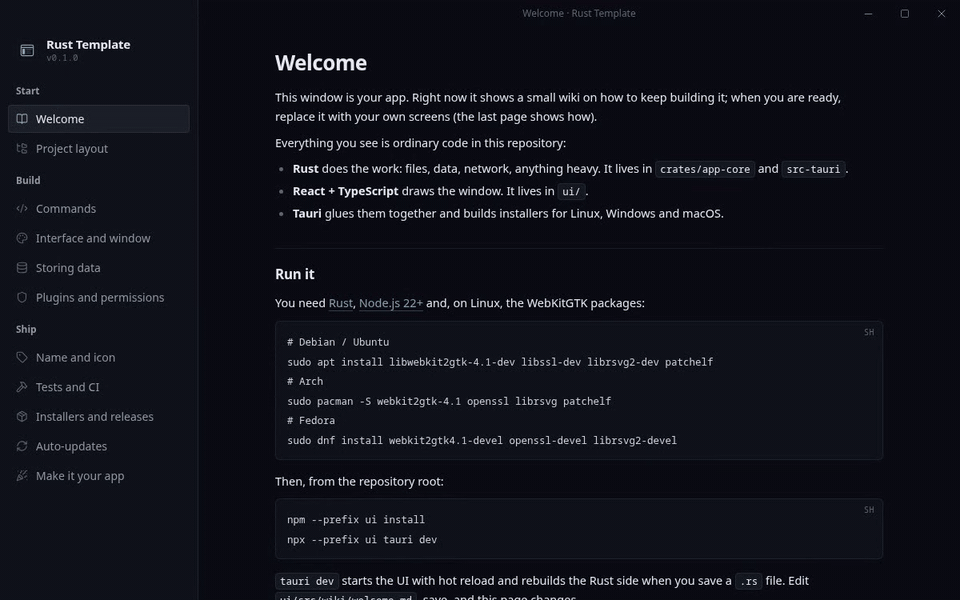
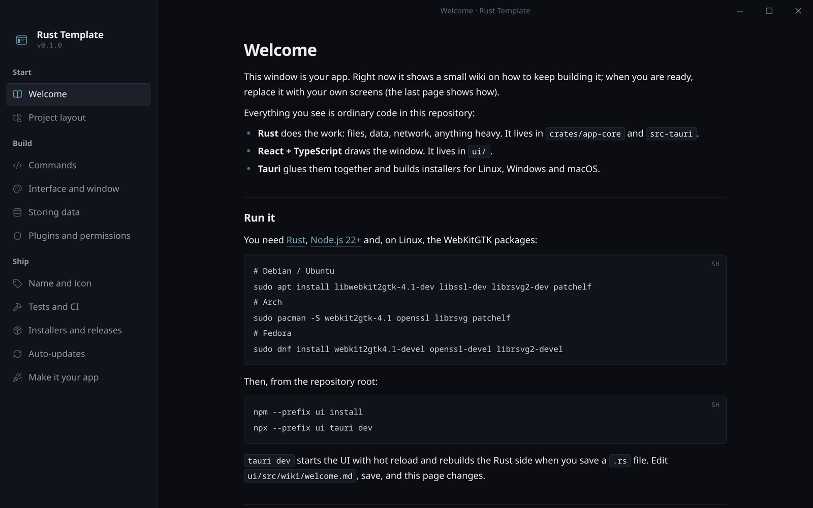
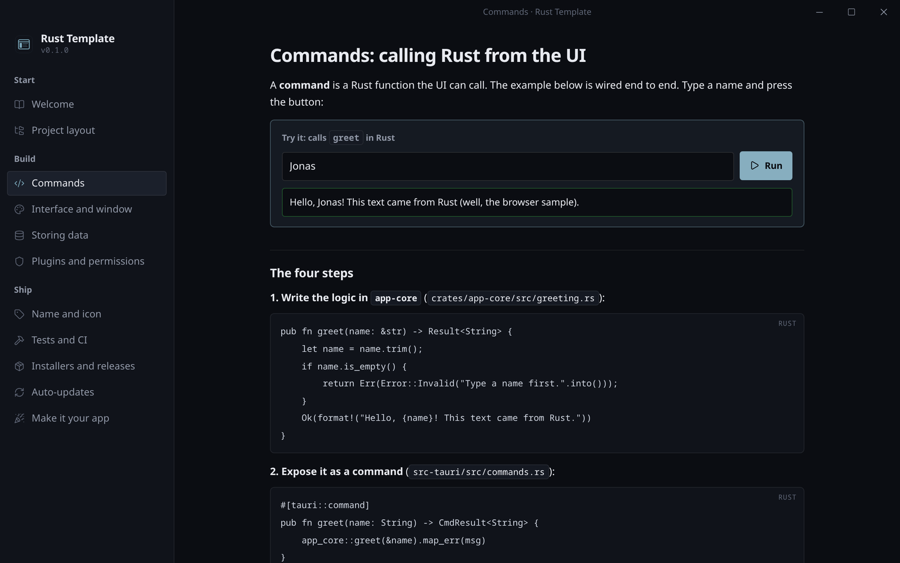
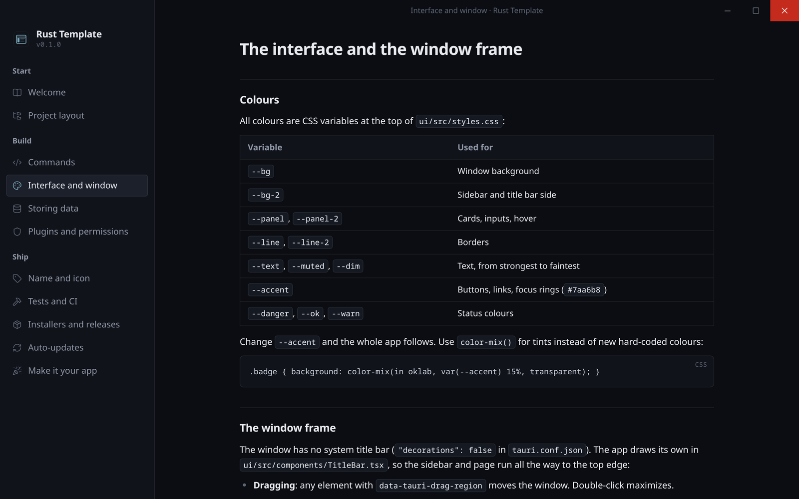
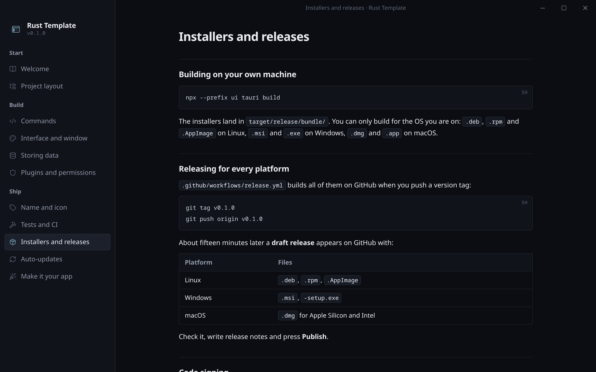

# Rust Template

A starting point for desktop apps in Rust. Clone it, rename it, and build whatever you want. It ships with:

- **A real window**: a frameless window with its own title bar, a dark theme, and native traffic lights on macOS.
- **A built-in wiki** as the first screen, explaining how to keep building: commands, storing data, plugins, icons, tests and releases. Delete it when you have your own screens.
- **Installers for every platform**: push a tag and GitHub Actions builds `.deb`, `.rpm` and `.AppImage` for Linux, `.msi` and `.exe` for Windows, and `.dmg` for macOS (Apple Silicon and Intel).
- **CI**: formatting, Clippy, Rust and UI tests, and a packaging check on every pull request.

Built with [Tauri 2](https://v2.tauri.app), React and TypeScript. The look comes from [Fjord](https://github.com/jhtjernsmo/fjord).



| The wiki is the first screen | Commands call Rust, live |
| --- | --- |
|  |  |
| **Fjord's window frame and colours** | **Installers for every platform** |
|  |  |

## Get started

You need [Rust](https://rustup.rs), [Node.js 22+](https://nodejs.org) and, on Linux, WebKitGTK:

```sh
# Debian / Ubuntu
sudo apt install libwebkit2gtk-4.1-dev libssl-dev librsvg2-dev patchelf
# Arch
sudo pacman -S webkit2gtk-4.1 openssl librsvg patchelf
# Fedora
sudo dnf install webkit2gtk4.1-devel openssl-devel librsvg2-devel
```

Then:

```sh
git clone https://github.com/jhtjernsmo/rust-template my-app
cd my-app
npm --prefix ui install
npx --prefix ui tauri dev
```

The app opens on the wiki. Everything else is explained there, and the same pages are in [`ui/src/wiki/`](ui/src/wiki) if you'd rather read them here.

## Make it yours

```sh
node scripts/rename.mjs "My App" com.yourname.myapp
npx --prefix ui tauri icon path/to/icon.png
```

The first command renames the app everywhere (window title, installers, package names). The second generates every icon size from one image.

## Layout

```text
crates/app-core/   Your app's logic, plain Rust, tested with cargo test
src-tauri/         The desktop shell: window, commands, permissions, icons
ui/                The window's contents (React + Vite), wiki pages in ui/src/wiki
scripts/rename.mjs Rename the app in one go
.github/workflows/ CI and the release build
```

## Commands

| Task | Command |
| --- | --- |
| Run with hot reload | `npx --prefix ui tauri dev` |
| Build installers for this OS | `npx --prefix ui tauri build` |
| Rust tests | `cargo test --workspace` |
| UI tests | `npm --prefix ui test` |
| UI in a browser, no Rust | `npm --prefix ui run dev` |
| Release for all platforms | `git tag v0.1.0 && git push origin v0.1.0` |

## Installing the release builds

The installers on the [Releases](https://github.com/jhtjernsmo/rust-template/releases) page show what a build of the template looks like. They are not code-signed, so:

- **macOS** may say the app is damaged or from an unidentified developer. Move it to Applications, then run `xattr -cr "/Applications/Rust Template.app"`.
- **Windows** SmartScreen may say "Windows protected your PC". Choose More info, then Run anyway.
- **Linux** needs nothing extra: install the `.deb` or `.rpm`, or make the `.AppImage` executable and run it.

The wiki page "Installers and releases" explains how to sign your own app so these warnings go away.

## License

Licensed under either of [Apache License, Version 2.0](LICENSE-APACHE) or [MIT license](LICENSE-MIT), at your option. Apps you build from this template can use any license you like.
